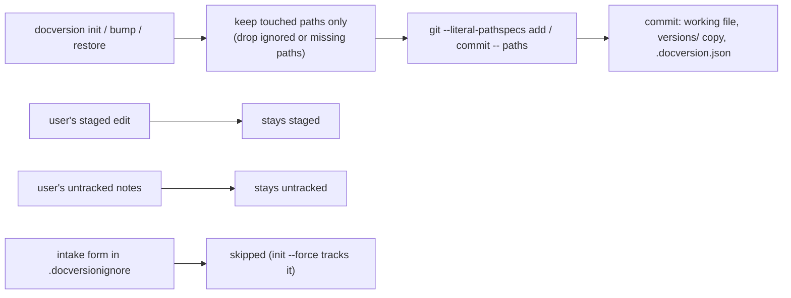

# docversion 0.1.2

## Fixed

- `init`, `bump` and `restore` commit only the files they touched. Before, they ran `git add -A` on the whole folder, so a commit could sweep in the user's other staged changes and untracked files.
- Every git call that takes a path uses `--literal-pathspecs`. A name such as `[Draft] v1.docx` is no longer read as a glob that also matches `D v1.docx`.
- A git-ignored path (for example, `versions/` listed in `.gitignore`) is left out of the commit instead of failing the whole commit. A path that neither exists nor is tracked is dropped too.
- "Nothing to commit" is treated as success.

## Changed

- `init` skips a file that matches `.docversionignore` and says so. Before, an explicit `init` tracked any file you named.
- New `init --force` tracks a matching file anyway.
- When `init` tracks no file, it writes nothing and makes no commit.
- README: new "Git commits" section and `.docversionignore` notes.

## Before / after

**Before**

```mermaid
flowchart LR
    A[docversion init / bump / restore] --> B["git add -A (whole folder)"]
    B --> C[commit]
    U1[user's staged edit] -. swept in .-> C
    U2[user's untracked notes] -. swept in .-> C
    G["#91;Draft#93; v1.docx read as a glob"] -. also matches D v1.docx .-> C
    I[intake form named in init] --> R[renamed and tracked]
```

**After**



## Diff summary

| File | Change |
|---|---|
| `src/docversion/gitutil.py` | `commit_all` and `rm_cached` replaced by `commit_paths`, which stages and commits only the given paths with `--literal-pathspecs`. |
| `src/docversion/cli.py` | `init`, `bump`, `restore` pass their touched paths; `init` honours `.docversionignore` and gains `--force`. |
| `src/docversion/core.py` | Docstring for the new ignore rule. |
| `tests/test_scoped_git.py` | 9 tests: unrelated staged and untracked files, deletion of the old working file, ignore and `--force`, unborn HEAD, bracket names, folder inside a larger repo, git-ignored `versions/`. |
| `README.md`, `pyproject.toml`, `uv.lock` | Docs and version 0.1.2. |

## Upgrade note

A folder that relied on `init <file>` tracking a file listed in `.docversionignore` now needs `init --force <file>`.
